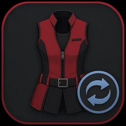
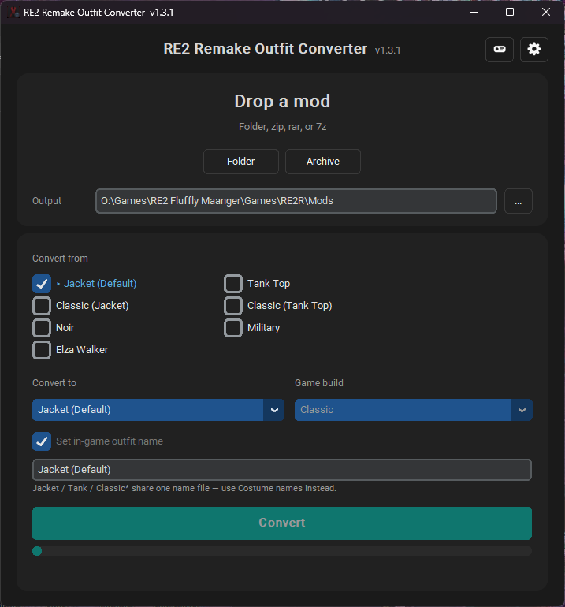
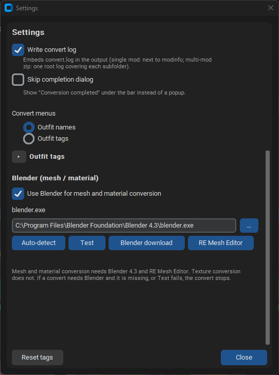
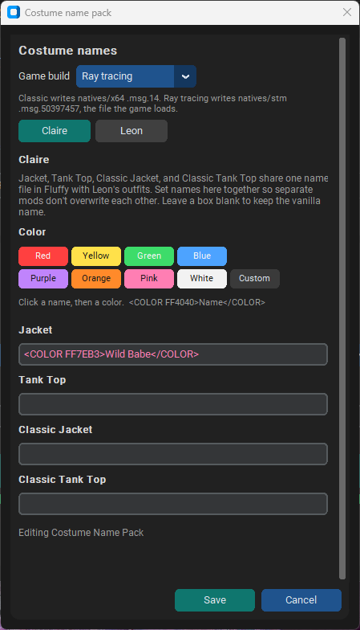

# RE2 Remake Outfit Converter

**Version 1.3.2**

A GUI tool (Windows exe + Linux package) that converts Resident Evil 2 Remake
(Fluffy Mod Manager) Claire and Leon costume mods from one outfit slot to
another — e.g. take a Claire mod made for Elza Walker and re-target it to Noir,
or a Leon Police mod to Casual.

## Screenshots

<p align="center">
  
</p>

<details open>
<summary>Main window, Settings, and Costume menu</summary>

**Main window**



**Settings**



**Costume menu**



</details>

## Quick start (release builds)

**Windows** — extract `RE2.Outfit.Converter.v1.3.2.Windows.zip`, run
`RE2 Outfit Converter.exe` from the extracted folder (keep `_internal` next
to the exe).

**Linux** — extract `RE2.Outfit.Converter.v1.3.2.Linux.zip`, run `./run.sh`
(opens the same GUI; needs Python 3.10+, `python3-tk`, and a desktop session —
see that package’s `README.txt`). Pack from source with `pack-linux.bat`.

GUI steps (Windows / Linux):
1. Drop a mod folder or `.zip` / `.rar` / `.7z` onto the window
   (Windows: `.rar` / `.7z` need [7-Zip](https://www.7-zip.org/);
   Linux: install `p7zip` so `7z` is on `PATH`).
2. Confirm source / target outfits, set an output folder, click **Convert**.
3. Drop the resulting `.zip` into Fluffy’s `Games\RE2R\Mods` folder
   **without extracting**.

Multi-select a main mod plus its AddonFor options to get one multi-mod `.zip`.

## Costume names

The header **Costume names** button opens a small editor that builds a Fluffy
**name pack** (not a body convert). Use it when you want custom costume-menu
labels for the outfits that share one game MSG file.

**Claire tab**

| Slot |
|------|
| Jacket |
| Tank Top |
| Classic Jacket |
| Classic Tank Top |

**Leon tab**

| Slot |
|------|
| Casual |
| Police |
| Police (Injured) |
| Classic Police |
| Classic Police (Injured) |

How it works:
1. Click **Costume names** → choose **Claire** or **Leon**.
2. Type new names (leave a box blank to keep vanilla).
3. Click **Create** → a zip like `Costume Name Pack.zip` is written to your
   output folder (`modinfo.ini` + the shared `mes_sys_costume` /
   `mes_sys_reward` files). If that pack already exists there, the editor
   opens its current names and **Save** overwrites the same zip.
4. Drop that zip into Fluffy **without extracting**, and enable it.

Notes:
- Claire and Leon edits in one Create/Save go into **one** pack so they do not
  overwrite each other.
- Enable only **one** costume name pack at a time in Fluffy (last enabled
  mod wins for those shared files).
- Convert-time **Set in-game outfit name** is for Claire **Elza / Noir /
  Military** and Leon **Noir / Arklay Sheriff** (each has its own MSG file).
  Jacket / Tank / Classic* and Leon’s slots above use **Costume names**
  instead.

## Layout

This directory is the git repository root (clone and work here). Pack scripts
write **inside the clone** so contributors do not need sibling folders:

| Folder | Purpose |
|--------|---------|
| `build/` | Local Windows test app (gitignored). PyInstaller scratch is removed after the copy. |
| `release/` | Windows/Linux pack output + Nexus zips (gitignored) |

Optional overrides (absolute paths): `RE2OC_BUILD_DIR`, `RE2OC_RELEASE_DIR`.

Run `rebuild.bat` from the repo root to refresh the test app under `build/`.

## Run from source

From this `Source/` folder:

```
pip install -r requirements.txt
python main.py
```

Requires Python 3.10+.

**Linux GUI from source / release tree:** `pip install -r requirements-linux.txt`
then `python main.py` (system Tkinter required).

See also:

- [CHANGELOG.md](CHANGELOG.md) — release notes
- [USER GUIDE.txt](USER%20GUIDE.txt) — end-user guide (ships with Windows zip)
- [docs/PIPELINE.md](docs/PIPELINE.md) — conversion stage order
- [docs/BINARY_PATCHING.md](docs/BINARY_PATCHING.md) — path overlay limits
- [docs/REVIEW_NOTES.md](docs/REVIEW_NOTES.md) — short review checklist

## Supported outfits

Convert menus show outfits for the character detected in the loaded mod
(Claire or Leon). Idle / empty state defaults to Claire.

### Claire

| Outfit            | PFB slot(s)              | Body mesh ID |
|-------------------|--------------------------|--------------|
| Jacket (Default)  | default, costume_1/2     | pl1000       |
| Tank Top          | costume_3/4              | pl1001       |
| Classic (Jacket)  | costume_5/6/7            | pl1002       |
| Classic (Tank Top)| costume_8/9              | pl1003       |
| Noir              | costume_a                | pl1005       |
| Military          | costume_b                | pl1006       |
| Elza Walker       | costume_c                | pl1004       |
| '98 Classic       | costume_d                | pl1007       |

### Leon

| Outfit                     | PFB slot(s)           | Body mesh ID | Hair   |
|----------------------------|-----------------------|--------------|--------|
| Casual                     | default               | pl0002       | pl0070 |
| Police                     | costume_1/2           | pl0000       | pl0070 |
| Police (Injured)           | costume_3/4           | pl0001       | pl0070 |
| Classic Police             | costume_5/6/7         | pl0003       | pl0070 |
| Classic Police (Injured)   | costume_8/9           | pl0006       | pl0070 |
| Noir                       | costume_a             | pl0004       | pl0074 |
| Arklay Sheriff             | costume_b             | pl0005       | pl0075 |
| '98 Classic                | costume_d             | pl0007       | pl0070 |

Claire `'98` and Leon `'98` are detect-only (omitted from convert menus).
Claire-only stages (Military clean-face, exclusive hat hide meshes) do not
run for Leon. Mixed Claire+Leon ops in one convert are rejected.

**In-game names on Convert** (separate DLC MSG files): Claire Elza / Noir /
Military; Leon Noir / Arklay Sheriff. Base Claire Jacket/Tank/Classic* and
Leon Casual/Police* use [Costume names](#costume-names) instead.

## What conversion does

- Renames Claire body PFB slots and mesh folders to the target outfit.
- Isolates shared face / hair meshes onto private IDs so Fluffy mods stop
  fighting over `pl1050` / `pl1070`.
- Isolates common shared outfit texture folders (`Pl2020`,
  `Escape/Character/Textures`) used by many CR-AW packs.
- Injects a hair redirect when converting into Noir / Military so
  vanilla hats do not reappear in gameplay, and seeds `pl1075` /
  `pl1071` with Claire hair meshes so the costume-select 3D preview
  matches (hat/headband hidden).
- Converting **to Military** auto-seeds Claire’s clean face when the mod
  has no face data; Tank Top strips leftover Military dirty face textures.
- Retargets author figure-gallery scenes onto the convert target (or base
  Claire paths for Jacket/Tank/Classic) so Records/Bonuses keep custom face/hair
  across DLC outfit slots (vanilla gallery + remapped body mesh).
- Patches same-length path strings inside engine binaries.
- Optionally sets DLC in-game costume names (Elza / Noir / Military).

The original mod is never modified.

Fluffy may still warn about **Ada** packs, weapon motion banks, or shared VFX
files — those are outside Claire outfit isolation.

## Tests

From this `Source/` folder:

```
pip install -r requirements.txt
pytest
```

## Build the Windows app

### Local / folder build (test copy)

From the repo root, run `rebuild.bat`. That installs dependencies if needed,
builds in a temporary folder, and syncs the runnable app to
`build/RE2 Outfit Converter/`. The temporary PyInstaller folders are removed
when the copy finishes.

Manual equivalent:

```
pip install -r requirements.txt pyinstaller
python -m PyInstaller --noconfirm --workpath %TEMP%\RE2-Outfit-Converter-build\pyi-work --distpath %TEMP%\RE2-Outfit-Converter-build\dist "RE2 Outfit Converter.spec"
```

Then sync that `dist\RE2 Outfit Converter\` folder to `build\RE2 Outfit Converter\`
and delete `%TEMP%\RE2-Outfit-Converter-build`.

### Production package

```
pack-windows.bat
```

Writes `release/RE2 Outfit Converter/` and
`release/RE2.Outfit.Converter.v1.3.2.Windows.zip` (folder build: exe + `_internal`).

## Build the Linux package

From the repo root on Windows, run `pack-linux.bat`. That stages the GUI
scripts, `main.py`, `requirements-linux.txt`, and `re2_outfit_converter/`, then
writes `release/RE2.Outfit.Converter.v1.3.2.Linux.zip`.

On Linux: extract, `chmod +x run.sh`, `./run.sh`.
